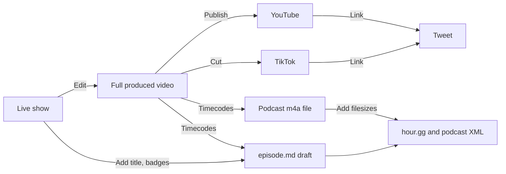

# Postproduction

Here are the steps for each episode.



## Produce the video with DaVinci Resolve

Cut the video, add chapter markers and save the artifacts.

- [ ] Save to `Season 20XX DaVinci timelines exports`
  - [ ] `YYYY-MM-DD-episode-###.drt` export this from the Media screen
- [ ] Save to `Produced full episodes`
  - [ ] `YYYY-MM-DD-episode-###.edl` export timecode markers from Timeline in cut page
  - [ ] `YYYY-MM-DD-episode-###.mp4` export from export page
    - [ ] Use "YouTube 1080p" settings.
    - [ ] Select Normalize > Optimize to standard

## Create the poster

Use Pixelmator Pro's YouTube poster templates.

- [ ] Save to `Produced full episodes`
  - [ ] `YYYY-MM-DD-episode-###.pxd` save as
  - [ ] `YYYY-MM-DD-episode-###.png` export

## Collect files for processing

> [!NOTE]
> Run this OUTSIDE of VS Code, since I have limited its permission to access disks.

```sh
EPISODE_MEDIA=/Volumes/FDBeta/Video\ production/Community\ Service\ Hour/Produced\ full\ episodes
EPISODE=$(basename "$(find $EPISODE_MEDIA/*.mp4 | sort | tail -n1)" .mp4)
echo $EPISODE # like 20##-##-##-episode-###
```

After verifying that episode is correct, then shuttle with:

```sh
cd ~/Sites/hour.gg/
rm -rf .production/
mkdir -p ./.production
cp $EPISODE_MEDIA/$EPISODE* ./.production
```

## Draft all episode parts

Use VS Code chat agent for each part:

```chat
/draft-audio
/draft-vtt
/draft-episode-file
/draft-youtube-description
/draft-shorts
/draft-x-thread
/draft-helpful-replies
```

## Deploy

1. Post to YouTube

   1. <https://youtube.com/upload>
   2. Copy from [.,/.production](../.production) > ....youtube-description.txt
   3. Add to CSH playlist
   4. Publish, get URL into the episode file

2. [TikTok](https://www.tiktok.com/@fulldecent) > [upload](https://www.tiktok.com/tiktokstudio/upload?from=creator_center&tab=video)

   1. Select the videos from [.,/.production](../.production)
   2. Add descriptions from [.,/.production](../.production)

3. X > [post](https://x.com/compose/post)

   1. Add thread from [.,/.production](../.production)
   2. Publish, get URL into the episode file

4. Deploy media

   ```sh
   EPISODE_MEDIA=/Volumes/FDBeta/Video\ production/Community\ Service\ Hour/Produced\ full\ episodes
   SHORTS=/Volumes/FDBeta/Video\ production/Community\ Service\ Hour/Clips
   cd ~/Sites/hour.gg/
   
   # Save to disk
   cp .production/*.m4a .production/*.vtt "$EPISODE_MEDIA"
   cp .production/*-short-*.mp4 "$SHORTS"
   
   # Post to network
   REMOTE_HOSTING_PATH='apps.phor.net:public_html/media/csh/'
   scp .production/*.m4a .production/*.png .production/*.vtt "$REMOTE_HOSTING_PATH"
   ```

5. Edit the episode file:

   ```diff
   - posted: false
   + posted: true
   ```

   and push.

6. Review `.production/$EPISODE.helpful-replies.md`, verify the episode links are live, and post appropriate helpful replies yourself.

7. After publishing and outreach are complete, keep any draft artifacts you want to retain, then delete `.production`.

## Draft upcoming episodes

If you have a scheduled date for upcoming episodes, then publish those as well (with `posted: false`) so they will publish on our .ics calendar files.

:warning: This overwrites existing episode files.

```sh
make_episode() { # NUMBER DATE_TIME_OFFSET
    export NUMBER=$1
    export DATE_TIME_OFFSET=$2

    # Validate YYYY-MM-DDTHH:MM:SS-XX:XX format
    if [[ ! $DATE_TIME_OFFSET =~ ^[0-9]{4}-[0-9]{2}-[0-9]{2}T[0-9]{2}:[0-9]{2}:[0-9]{2}-[0-9]{2}:?[0-9]{2}$ ]]; then
        echo "Invalid date-time format, use YYYY-MM-DDTHH:MM:SS-XX:XX"
        return 1
    fi

    DATE=$(echo $DATE_TIME_OFFSET | cut -d'T' -f1)
    BASENAME="$DATE-episode-$NUMBER"
    EPISODE_FILE="_episodes/$BASENAME.md"
    export URL="https://media.phor.net/csh/$BASENAME.m4a"
    export IMAGE_URL="https://media.phor.net/csh/$BASENAME.png"
    export UUID=$(uuidgen)
    cp _drafts/YYYY-MM-DD-episode-N.md $EPISODE_FILE
    yq -i --front-matter="process" '.guid = env(UUID)' $EPISODE_FILE
    yq -i --front-matter="process" '.enclosure-url = env(URL)' $EPISODE_FILE
    yq -i --front-matter="process" '.itunes-image = env(IMAGE_URL)' $EPISODE_FILE
    yq -i --front-matter="process" '.itunes-episode = env(NUMBER)' $EPISODE_FILE
    yq -i --front-matter="process" '.start-time = env(DATE_TIME_OFFSET)' $EPISODE_FILE
}

# Use New York time zone for time offset (-0400 in Summer EDT, -0500 in EST)
make_episode 130 '2024-08-20T18:00:00-04:00'
make_episode 131 '2024-08-27T18:00:00-04:00'
make_episode 132 '2024-09-03T18:00:00-04:00'
make_episode 133 '2024-09-17T18:00:00-04:00'
make_episode 134 '2024-09-24T18:00:00-04:00'
```
